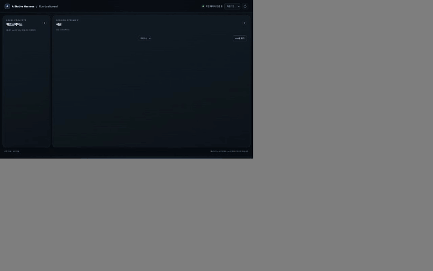

[한국어](README.md)

# ai-native-sdlc

[](https://github.com/HakjunMIN/ai-native-harness/actions/workflows/validate.yml)
[](https://github.com/HakjunMIN/ai-native-harness/actions/workflows/lint.yml)
[](CHANGELOG.md)
[](package.json)


**A local development workflow where AI implements, evidence verifies, and people approve.**
Start from a Jira ticket or a natural-language request, with <!-- skill-count -->37 skills
and 9 specialized agents. Discovery asks people what it needs up front; planning,
implementation and verification then follow the recommendations and stop only for
critical matters.

## Software Engineering Principles

**Prioritize verification proportional to change risk and clear ownership boundaries over procedural volume.**

| Principle | How the workflow applies it |
|---|---|
| Deliver small vertical increments | Split work into sub tasks with user outcomes and acceptance criteria (AC), rather than separate database, API, and UI layers. |
| AC-based verification and validation | At G1, people validate intent through AC and Gherkin scenarios, including prototypes for UI work. Final verification checks the implementation against per-AC test results (Go `testing` or JUnit, Playwright E2E). |
| Contracts and boundaries first | Align domain terminology, API contracts, and test expectations. Preserve authentication, tenant, and product boundaries. |
| Risk-based verification | Use light mode for a small, low-risk, single outcome. Use strict mode for high-risk changes, architectural changes, or multiple outcomes. |
| Tests appropriate to the change | Use TDD (RED to GREEN) for behavior changes, before-and-after comparisons for refactoring, and relevant static checks for documentation and configuration. |
| Independent review and separated roles | A model other than the author's reviews the work, with at most two rounds per review subject. Work split into several sub tasks reviews only risk-mapped sub tasks individually and reviews the whole change once at the parent ticket. Strict mode also separates test writing from implementation. |
| Evidence-based completion and traceability | Bind tests, reviews, and approvals to file hashes and code revisions. Revalidate evidence invalidated by changes. |
| Human approval and operations | People approve requirements (G1), plans (G2), and operational changes (G5b). Agents cannot approve their own work or perform actual production changes. |

Details: [Shared principles](skills/sdlc/references/principles.md) and
[workflow protocol](skills/sdlc/references/protocol.md).

## Scope and Flow

The default technical guidance targets an observability stack:
**Grafana datasource/panel/app + React/TypeScript -> BFF -> SigNoz query-service**.
The BFF is Go by default (`go-backend` and `go-testing`); Spring Boot (Gradle) is also
supported. The BFF does not access ClickHouse directly, and the SigNoz UI is not
exposed. Use the harness in a monorepo or across multiple microservice repositories;
`sdlc-setup` confirms each repository's paths, commands, and project baseline.

**Discovery -> Plan -> Implement -> Verify -> Release**


`sdlc` manages progress, pauses, and resumption. Technical skills can run independently;
invoking one does not start the SDLC workflow or Jira work. Technical skills retrieve
official documentation at execution time instead of shipping static product manuals.
If retrieval fails, they report `BLOCKED` rather than substituting model memory.
See the [Live documentation protocol](skills/sdlc/references/live-documentation.md).

## Installation

Git and **Node.js 22 or later** are required. The repository is public, so
installation needs no authentication.

### Microservices: Share the Harness Across Sibling Repositories

For service repositories under the same parent directory, use a **shared clone with
symbolic links**. The installer clones `ai-native-harness` next to the services, or
updates it with `git pull --ff-only`, and then links each repository.

```text
workspace/
├── ai-native-harness/        # Shared Git clone of skills, hooks, and agents
├── .ai-native-sdlc-revisions/ # Shared revision cache created with the first ticket
├── service-api/
└── service-web/
    ├── .ai-native-sdlc -> ../ai-native-harness
    ├── AGENTS.md -> .ai-native-sdlc/templates/project-AGENTS.md
    ├── .agents/skills/* -> ../../.ai-native-sdlc/skills/*
    ├── .github/agents/* -> ../../.ai-native-sdlc/agents/*
    └── docs/sdlc/<ID>/       # This service's state, lock, and task history
```

```bash
set -o pipefail
curl -fsSL 'https://raw.githubusercontent.com/HakjunMIN/ai-native-harness/main/install-shared.sh' |
  bash -s -- /workspace/service-api /workspace/service-web
```

```powershell
$url = 'https://raw.githubusercontent.com/HakjunMIN/ai-native-harness/main/install-shared.ps1'
& ([scriptblock]::Create((Invoke-WebRequest -Uri $url).Content)) `
  'C:\workspace\service-api' 'C:\workspace\service-web'
```

On Windows, symbolic links require **Developer Mode or administrator privileges**.
Rerunning updates shared assets; existing tickets keep their locks. Existing
`AGENTS.md` files and conflicting files are not overwritten, and the installer adds a
`/.worktrees/` rule to `.gitignore`.

### Copy Into a Project

```bash
set -o pipefail
curl -fsSL 'https://raw.githubusercontent.com/HakjunMIN/ai-native-harness/main/install.sh' |
  bash -s -- /absolute/path/to/target-repo
```

See [Installation](docs/install.md) for running without piping a remote script,
options, updates, conflicts, and host checks, and [Compatibility](docs/compatibility.md)
for permission and hook limitations.

## Getting Started

Run **`sdlc-setup` once** in the target repository. It reads the repository, CI, and
deployment targets with read-only `gh`, `az`, and `kubectl` queries first, then asks
you to confirm module paths, test and quality commands, models, and the locations of
shared standards and ADRs in one pass. Tokens are not stored in configuration.

```text
sdlc-setup

sdlc ABC-123
or
sdlc Improve the empty state of the document search screen
```

- **Jira:** requires an authenticated Atlassian Rovo MCP connection. Light mode uses the parent issue; strict mode creates child tickets after G2 approval.
- **Local:** asks only necessary questions and records the original request and answers in `intake.md`. Human approvals and verification criteria match Jira work.
- **Resume:** use `sdlc` to list saved work and `sdlc <ID>` to continue. Artifacts and state live in `docs/sdlc/<ID>/`.

### Discovery: Questions and G1 Approval

The agent first investigates what it can establish from code, existing answers, and
project standards, then batches now the decisions later phases need. Decisions it can
draft become recommendations. At G1, chat shows the goal, scope and exclusions, a small
Mermaid behavior diagram, and a summary of AC, decisions, and risks; approval binds to
the whole document's hash. High-risk choices need individual confirmation from the
decision owner. See the [Approval example](examples/ABC-123/01-discovery.md),
[format and question criteria](skills/sdlc/references/discovery-review.md), and
[operating procedure](docs/operations.md#discovery-승인-요약).

### Autonomous Execution and the Decision Log

Runs started with 0.3.0 or later also confirm execution preferences in the G1
form: whether the change touches UI (`uiChange`), the E2E level (`full` default,
`regression`, `none`), standing local Git grants (`plan-commit`, `slice-commit`,
`local-integration`) and residual review findings (`follow-up` default, `human`).
Plan and implementation then follow the recommendations and log non-critical
choices in the run's `decisions.md`. Only critical matters stop for a person:
authority, auth/tenant changes, destructive data changes, public contract breaks,
security issues, AC or scope changes, secrets and production effects. G2 and G5b
approval and any push, merge, PR publication or production action stay with
people. The G2 form also shows the proceed agreement in `02-plan.md`: inside the
approved sub tasks and ACs, implementation, tests, review fixes and verification
are reported as progress, not asked about, and only work that hits a plan-specific
stop condition (for example a real external connection or a new write permission)
pauses for a decision. After review round 2 the agent accepts remaining findings
only when the reviewer classified them as non-critical (`critical: 0`), with
follow-ups and a logged decision. The release report lists every decision.

Verification binds passing reports of the approved code quality policy (lint,
format-check and typecheck) to each slice, G3 and G4. The Go BFF uses
`golangci-lint run ./...`, `golangci-lint fmt --diff` and `go build ./...`. UI
changes need Playwright AC checks, and `full` adds affected-flow, smoke regression
and exploratory browser E2E. Quality checks run during implementation and
verification, not in hooks. See
[autonomous execution](skills/sdlc/references/protocol.md#autonomous-execution),
[code quality](skills/sdlc/references/code-quality.md), and the
[operating procedure](docs/operations.md#자율-실행품질e2e-contract-2).

### Progress and Sub Tasks

For status requests, resumption, phase changes, approval waits, blockers, and
completion, the agent shows a Mermaid progress diagram and the next action with the
task ID in chat. Manual inspection does not change files or approval state:

```sh
node .ai-native-sdlc/scripts/state.mjs progress docs/sdlc/ABC-123/state.json --text
```

**A sub task is an execution unit with AC, scope, and dependencies; a Jira ticket is
a remote issue.** Large requests become several sub tasks. A single sub task runs in
the run worktree; independent parallel sub tasks run in separate Git worktrees and
are verified after integration.

**Review happens once at the parent ticket, not again for every sub task.** Plans
with several sub tasks prepared on 0.3.1 or later record `risks` for each sub task.
Only sub tasks mapped to a planned risk, such as auth or tenant boundaries,
destructive or schema changes, public compatibility or security impact, get spec
and standards review before completion. The rest (`risks: []`) need their AC tests,
quality checks and integration evidence, and the whole change gets one final review
with security coverage at G4. The G2 plan review checks the risk mapping, and
missing or undeclared risks are rejected when the plan is prepared. Single sub task
plans and tickets already in progress keep their existing review rules. See the
[review policy](skills/sdlc/references/protocol.md#review-policy-for-decomposed-contract-2-plans),
[progress inspection](docs/operations.md#진행-상황-조회), and the
[Sub task contract](skills/sdlc-subtasks/references/sub-task-contract.md).

### Per-Ticket Revisions and Run Worktrees

**Share the installation, but pin the execution baseline per ticket.** Each task records
the content SHA256 of its assets in `docs/sdlc/<ID>/harness.lock.json` and resumes from
the same snapshot in `.ai-native-sdlc-revisions/<SHA256>/`. Updating the installation
does not switch active work; switching is an explicit `harness.mjs upgrade` that
revalidates from G0. Every new run works in its own worktree at
`.worktrees/sdlc/<ID>/integration` inside the primary checkout (branch
`sdlc/<ID>/integration`). Commit locks, state, and task history; exclude the cache.
The agent creates and verifies locks, so you do not need to run commands yourself.
See [Ticket revisions](skills/sdlc/references/harness-revisions.md) and the
[branch and worktree procedure](docs/operations.md#브랜치와-병렬-워크트리).

### PR Bodies, Retrospectives, and Unused Code Audits

- **`pr`** writes a PR body for a reviewed diff with Summary, Evidence, Merge Danger, and Traceability. It writes the body only; it does not push or merge.
- **`retro`** runs only when you invoke it and proposes improvements from actual friction. Only accepted changes persist in standards or automated checks after owner approval.
- **[prune-unused](skills/prune-unused/SKILL.md)** is a human-invoked, read-only audit. It reports candidates with evidence and risk, cleans up only what a person selects, and is not registered with a scheduler or CI.

## Project Baselines and ADRs

**Standards define current rules; ADRs explain why a decision was made.** Decisions
affecting multiple features, such as authentication, tenancy, and shared APIs, belong
in project ADRs, and feature plans reference them. Prefer the target project's existing
documentation locations; without a convention, use this structure.

```text
AGENTS.md                  # Actual documentation locations and reading rules
docs/
  architecture/adr/        # Shared decisions: rationale, alternatives, approval (README.md index)
  standards/               # Current rules and enforcement (README.md index)
  sdlc/<ID>/               # state.json, harness.lock.json, 02-plan.md, and other task records
```

For repository documents, the plan's `Project baseline` records paths and commits, and
later phases check changes since then. Shared changes and exceptions require their
owner's approval; feature-level G2 approval cannot substitute for it. The installer
does not create empty standards or ADRs. See
[Project governance](skills/sdlc/references/project-governance.md).

### Using decisions from Confluence, Slack, and Jira as project standards

Keep the originals in place. In the project's standards index (e.g. `docs/standards/README.md`),
record **where to look, which decisions apply, and who can approve them**.
`sdlc-setup` follows existing documentation and links to suggest Confluence pages, Slack decision channels, and Jira projects.
Register a source only after the project owner confirms its lookup scope, applicability, decision owner, and accepted approval record.
Without registered sources, use repository standards only. See the [source registration format and approval criteria](skills/sdlc/references/project-governance.md#external-governance-sources).

Both SDLC and standalone skills use read-only access within the current registered scope.
For example, apply a release owner's approved pre-deployment check in Confluence without seeking approval again.
A Slack suggestion to skip it or a Jira exception granted only for the previous release does not waive the check.
In the SDLC plan's `Project baseline`, record the shareable decision reference, scope, approval evidence,
UTC check time, and source revision (or content hash if unversioned). If required evidence is inaccessible
or conflicts with a current standard, pause only the work that depends on it.

## Safety Boundaries

**Hooks conservatively block `git push`, `gh pr merge`, and direct cluster changes.**
`az` and `gh` pass only for read-only observation (`az … show|list|query`,
`gh pr|run view`, `gh api` GET, and similar) and a few set commands such as
`gh pr|issue comment` and draft PR creation; other commands are denied as requiring
the human operator. The harness uses these reads to find CI and deployment facts
first and asks only for confirmation.

Only the conductor integrates locally, under user authorization or the
`local-integration` grant. People publish branches, promote dev or staging, change
actual production values, merge, and synchronize ArgoCD; agents write production
change proposals only under `production-proposal/`. Hooks and role-specific path
restrictions are **not a security sandbox**. GitHub branch protection, required CI,
and ArgoCD production RBAC are still required. If required verification or review is
unavailable, the task is blocked, not passed. See [hook limits](docs/operations.md#훅-한계).

## Further Reading

The linked guides retain their existing language.

| Resource | Coverage |
|---|---|
| [Installation](docs/install.md) | Shared microservice and copy installations, Bash/PowerShell, updates, and conflicts. |
| [Operations](docs/operations.md) | Light/strict policy, approvals, resumption, progress inspection, parallel worktrees, autonomous execution, and existing state migration. |
| [Ticket revisions](skills/sdlc/references/harness-revisions.md) | Per-ticket locks, caches, resumption, recovery, explicit version changes, `.gitattributes`, and inheritance. |
| [Compatibility](docs/compatibility.md) | Host support and permission and hook limitations. |
| [Customer repository discovery](docs/customer-repository-discovery.md) | Interview questions, artifact templates, tool and permission discovery, process mapping, and pilot criteria. |
| [Project governance](skills/sdlc/references/project-governance.md) | Shared standards and ADRs, external decision sources, baseline versions, approvals, exceptions, promotion, supersession, and impact checks. |
| [Sub task example](examples/ABC-123/README.md) | Plans, sub tasks, and evidence artifact structure. |
| [Technical skills](skills/) | Independently usable stack-specific development, testing, and operational guidance. |
| [Go Backend](skills/go-backend/SKILL.md) and [Go Testing](skills/go-testing/SKILL.md) | Go BFF/backend implementation and `go test` evidence. [samber/cc-skills-golang](https://github.com/samber/cc-skills-golang) is retrieved only as a non-authoritative checklist. |
| [SigNoz OSS](skills/signoz-oss/SKILL.md), [ClickStack](skills/clickstack/SKILL.md), [Mimir OSS](skills/mimir-oss/SKILL.md), and [Prometheus Query API](skills/prometheus-query-api/SKILL.md) | Observability storage and query-service operations and alternative evaluation. Nothing is installed or migrated automatically without an approved decision. |
| [Local SDLC run dashboard](docs/dashboard.md) | Session-to-run linking, VS Code links and resume commands, alerts, refresh intervals, storage locations, and per-OS use. |

## Package Development

```bash
npm ci            # install ESLint development dependencies
npm test
npm run lint
npm run validate
```

These commands validate the package without external services. They do not replace
target-service tests or actual Jira/ArgoCD connectivity checks. CI runs the same checks
in the `Validate plugin` (macOS, Linux, Windows) and `Lint` (ESLint) workflows. When
changing skills, also run the [Pressure scenarios](tests/scenarios/pressure.md).

### Local SDLC run dashboard



Run `npm run dashboard` and open the `127.0.0.1` URL printed in the terminal. The
dashboard shows local GitHub Copilot CLI, Claude Code, and Codex session files and
SDLC run evidence read-only; session content is not uploaded. Sessions link to runs
automatically from harness tool activity, and you can link unlinked sessions manually.
Session cards open the session in VS Code or copy its resume command. It shows
approval status but cannot approve gates or change run state. See the
[dashboard guide](docs/dashboard.md).

### Maintaining the harness: `harness-dev`

Use [`harness-dev`](.agents/skills/harness-dev/SKILL.md) in this source repository to
improve the harness itself; it is not installed in consuming projects. When approval
rules or state formats change, check compatibility and rollback for tickets already in
progress first. Record designs in [design documents](docs/specs/) and implementation
plans in [`docs/plans/`](docs/plans/), whichever tool produced them.
