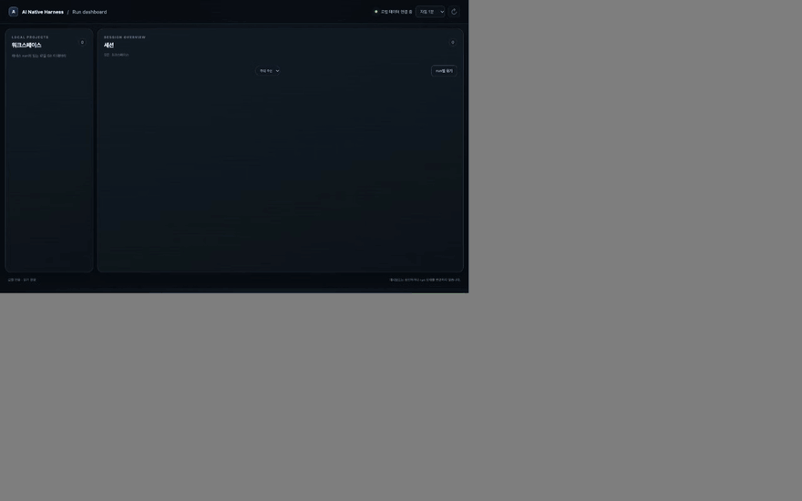

[English](README.en.md)

# ai-native-sdlc

[](https://github.com/HakjunMIN/ai-native-harness/actions/workflows/validate.yml)
[](https://github.com/HakjunMIN/ai-native-harness/actions/workflows/lint.yml)
[](CHANGELOG.md)
[](package.json)


**AI가 구현하고, 증거로 검증하며, 사람이 승인하는 로컬 개발 워크플로우.**
Jira 티켓 또는 자연어 요청에서 시작하며, <!-- skill-count -->37개 스킬과 9개 전문 에이전트를 제공합니다.
Discovery에서 사람에게 필요한 것을 충분히 묻고, 이후 계획·구현·검증은 권장안으로
진행하며 중대 사항만 확인을 요청합니다.

## 소프트웨어 엔지니어링 원칙

**절차의 양보다 변경 위험에 맞는 검증과 명확한 책임 경계를 중시합니다.**

| 원칙 | 워크플로우에 적용하는 방식 |
|---|---|
| **작은 수직 단위로 전달** | DB/API/UI 계층별 작업 대신, 사용자 결과와 수용 기준(AC)을 갖춘 sub task로 나눕니다. |
| **AC 기반 Verification & Validation** | G1에서 AC·Gherkin 시나리오(UI는 프로토타입 포함)로 요구 의도를 확인하고, 최종 검증에서 AC별 테스트(Go `testing`·JUnit, Playwright E2E) 결과로 구현 충족을 확인합니다. |
| **계약과 경계 우선** | 도메인 용어·API 계약·테스트 기대값을 맞추고, 인증·테넌트·제품 경계를 보존합니다. |
| **위험 기반 검증** | 작고 저위험인 단일 결과는 light, 고위험·아키텍처 변경·다중 결과는 strict로 진행합니다. |
| **변경에 맞는 테스트** | 동작 변경은 TDD(RED → GREEN), 리팩터링은 전후 비교, 문서·설정은 관련 정적 검증을 적용합니다. |
| **독립 리뷰와 역할 분리** | 작성자와 다른 모델이 리뷰하며, 리뷰 대상별 2라운드가 상한입니다. Strict는 테스트 작성과 구현 역할도 분리합니다. |
| **증거 기반 완료와 추적성** | 테스트·리뷰·승인을 파일 해시와 코드 revision에 연결하고, 변경으로 무효화된 증거는 재검증합니다. |
| **사람이 결정하는 승인과 운영** | 요구사항(G1), 계획(G2), 운영 반영(G5b)은 사람이 승인합니다. 에이전트는 스스로 승인하거나 실제 운영 변경을 수행하지 않습니다. |

세부 기준: [공통 원칙](skills/sdlc/references/principles.md) ·
[워크플로우 프로토콜](skills/sdlc/references/protocol.md)

## 대상과 흐름

기본 기술 지침은 **Grafana datasource/panel/app + React/TypeScript → BFF → SigNoz
query-service** 관측성 스택을 대상으로 합니다. BFF는 Go가 기본(`go-backend`·`go-testing`)이며
Spring Boot(Gradle)도 지원합니다. BFF는 ClickHouse에 직접 접근하지 않으며 SigNoz 자체 UI는
노출하지 않습니다. 모노레포와 여러 MSA 리포에서 사용할 수 있으며, 리포별 경로·명령·공통
기준은 `sdlc-setup`으로 확인합니다.

**Discovery → Plan → Implement → Verify → Release**


`sdlc`가 진행·중단·재개를 관리합니다. 기술 스킬은 독립적으로 사용할 수 있으며, 호출만으로
SDLC나 Jira 작업이 시작되지는 않습니다. 기술 스킬은 정적 제품 매뉴얼 대신 실행 시점에 공식
문서를 조회하고, 조회에 실패하면 모델 기억으로 대체하지 않고 `BLOCKED`로 보고합니다.
[실시간 기술 문서 조회 프로토콜](skills/sdlc/references/live-documentation.md)

## 설치

Git과 **Node.js 22 이상**이 필요합니다. 공개 저장소이므로 인증 없이 설치할 수 있습니다.

### MSA: 형제 리포에서 하네스 공유

여러 서비스 리포가 같은 상위 디렉터리에 있다면 **공유 클론 + 심볼릭 링크** 설치를 사용하세요.
설치기는 서비스 리포 옆에 `ai-native-harness`를 클론하거나 `git pull --ff-only`로 갱신한 뒤
각 리포에 링크를 만듭니다.

```text
workspace/
├── ai-native-harness/       # 공통 스킬·훅·에이전트의 Git 클론
├── .ai-native-sdlc-revisions/ # 첫 티켓 생성 시 만드는 공유 리비전 캐시
├── service-api/
└── service-web/
    ├── .ai-native-sdlc -> ../ai-native-harness
    ├── AGENTS.md -> .ai-native-sdlc/templates/project-AGENTS.md
    ├── .agents/skills/* -> ../../.ai-native-sdlc/skills/*
    ├── .github/agents/* -> ../../.ai-native-sdlc/agents/*
    └── docs/sdlc/<ID>/      # 해당 서비스의 상태·lock·작업 이력
```

```bash
set -o pipefail
curl -fsSL 'https://raw.githubusercontent.com/HakjunMIN/ai-native-harness/main/install-shared.sh' |
  bash -s -- /workspace/service-api /workspace/service-web
```

```powershell
$url = 'https://raw.githubusercontent.com/HakjunMIN/ai-native-harness/main/install-shared.ps1'
& ([scriptblock]::Create((Invoke-WebRequest -Uri $url).Content)) `
  'C:\workspace\service-api' 'C:\workspace\service-web'
```

Windows에서 심볼릭 링크를 만들려면 **개발자 모드 또는 관리자 권한**이 필요합니다. 재실행하면
공통 자산이 갱신되지만 기존 티켓은 자신의 lock을 유지합니다. 기존 `AGENTS.md`와 충돌 파일은
덮어쓰지 않으며, `.gitignore`에 `/.worktrees/` 규칙을 추가합니다.

### 프로젝트 내부 복사 설치

```bash
set -o pipefail
curl -fsSL 'https://raw.githubusercontent.com/HakjunMIN/ai-native-harness/main/install.sh' |
  bash -s -- /absolute/path/to/target-repo
```

원격 스크립트를 직접 실행하지 않는 방법, 옵션, 업데이트·충돌 처리와 호스트별 확인은
[설치 안내](docs/install.md)를, 권한·훅의 한계는 [호환성](docs/compatibility.md)을 참고하세요.

## 시작

대상 저장소에서 **최초 한 번 `sdlc-setup`**을 실행합니다. 저장소·CI·배포 대상은 `gh`·`az`·
`kubectl` 읽기 전용 조회로 먼저 파악하고, 모듈 경로·테스트·품질 명령·모델과 공통 표준·ADR
위치를 한 번에 확인받습니다. 설정에 토큰은 저장하지 않습니다.

```text
sdlc-setup

sdlc ABC-123
또는
sdlc 문서 검색 화면의 빈 상태를 개선해줘
```

- **Jira:** Atlassian Rovo MCP 연결·인증이 필요합니다. Light는 부모 이슈로, strict는 G2 승인 후 자식 티켓을 발행해 구현합니다.
- **로컬:** 필요한 사항만 확인해 원래 요청과 답변을 `intake.md`에 기록합니다. 사람 승인과 검증 기준은 Jira 작업과 같습니다.
- **재개:** `sdlc`로 저장된 작업 목록을 보고 `sdlc <ID>`로 이어갑니다. 산출물과 상태는 `docs/sdlc/<ID>/`에 저장합니다.

### Discovery: 질문과 G1 승인

AI가 코드·기존 답변·프로젝트 기준으로 확인할 수 있는 내용은 먼저 조사하고, 이후 단계에 필요한
결정은 지금 묶어 질문합니다. 초안을 만들 수 있는 결정은 추천안으로 제시합니다. G1에서는
목표, 범위/제외, 작은 Mermaid 동작도, AC·결정·위험 요약을 채팅에 보여 주고 승인은 문서
전체의 해시에 묶습니다. 고위험 선택은 결정권자가 항목별로 확인합니다.
[승인 예시](examples/ABC-123/01-discovery.md) ·
[형식과 질문 기준](skills/sdlc/references/discovery-review.md) ·
[운영 절차](docs/operations.md#discovery-승인-요약)

### 자율 실행과 의사결정 기록

0.3.0 이후 시작한 run은 G1 폼에서 실행 선호도도 함께 확인합니다. 확인 항목은 UI 변경
여부(`uiChange`), E2E 수준(`full` 기본, `regression`, `none`), 로컬 Git 상시 권한
(`plan-commit`, `slice-commit`, `local-integration`), 잔여 리뷰 지적 처리(`follow-up` 기본,
`human`)입니다. 이후 계획과 구현은 권장안으로 진행하고 비중대 결정은 run의 `decisions.md`에
기록합니다. 권한·인증/테넌트·파괴적 데이터 변경·공개 계약 파괴·보안 취약점·AC/범위
변경·비밀정보·운영 반영 같은 중대 사항만 사람에게 묻습니다. G2·G5b 승인과 push·merge·PR
게시·운영 반영은 계속 사람이 담당합니다. G2 승인 폼에는 `02-plan.md`의 진행 합의도 함께
표시됩니다. 승인된 sub task·AC 안의 구현·테스트·리뷰 수정·검증은 묻지 않고 진행 보고만
하며, 계획별 멈춤 조건(예: 실제 외부 연결, 새 쓰기 권한)에 걸린 작업만 멈추고 묻습니다.
리뷰 2라운드 후 남은 지적은 리뷰어가 비중대(`critical: 0`)로 분류한 경우에만 follow-up과
결정 기록을 남기고 에이전트가 수용하며, 릴리스 보고서에 전체 결정 목록을 남깁니다.

검증 단계에서는 승인된 코드 품질 정책(lint·format-check·typecheck)의 통과 보고서를
슬라이스·G3·G4에 묶습니다. Go BFF는 `golangci-lint run ./...`, `golangci-lint fmt --diff`,
`go build ./...`를 사용합니다. UI 변경에는 Playwright AC 검사가 필요하며, `full`은 영향 흐름·
smoke 회귀·탐색적 브라우저 E2E까지 수행합니다. 품질 검사는 훅이 아니라 구현·검증 단계에서
실행합니다.
[자율 실행](skills/sdlc/references/protocol.md#autonomous-execution) ·
[코드 품질](skills/sdlc/references/code-quality.md) ·
[운영 절차](docs/operations.md#자율-실행품질e2e-contract-2)

### 진행 상황과 하위 작업

상태 조회·재개·단계 전환·승인 대기·차단·완료 시 에이전트가 작업 ID와 함께 Mermaid 진행도와
다음 행동을 채팅에 표시합니다. 수동 조회는 파일이나 승인 상태를 바꾸지 않습니다.

```sh
node .ai-native-sdlc/scripts/state.mjs progress docs/sdlc/ABC-123/state.json --text
```

**sub task는 AC·범위·의존성을 가진 실행 단위이고, Jira 티켓은 원격 이슈입니다.**
큰 요청은 여러 sub task로 나눕니다. 단일 sub task는 run 워크트리에서, 독립적인 병렬 sub task는
별도 Git 워크트리에서 수행한 뒤 통합 검증합니다.
[진행 상황 조회](docs/operations.md#진행-상황-조회) ·
[sub task 계약](skills/sdlc-subtasks/references/sub-task-contract.md)

### 티켓별 리비전과 run 워크트리

**설치는 공유할 수 있고, 실행 기준은 티켓별로 고정합니다.** 각 작업은
`docs/sdlc/<ID>/harness.lock.json`에 자산의 콘텐츠 SHA256을 기록하고, 재개할 때
`.ai-native-sdlc-revisions/<SHA256>/`의 같은 스냅샷을 사용합니다. 설치를 갱신해도 진행 중인
작업은 자동 전환되지 않으며, 전환은 `harness.mjs upgrade`로 명시하고 G0부터 재검증합니다.
새 run은 primary checkout 안의 `.worktrees/sdlc/<ID>/integration` 전용 워크트리(브랜치
`sdlc/<ID>/integration`)에서 진행합니다. lock·상태·작업 이력은 커밋하고 캐시는 제외하세요.
lock 생성과 검증은 에이전트가 수행하므로 사용자가 별도 명령을 실행할 필요는 없습니다.
[티켓 리비전 관리](skills/sdlc/references/harness-revisions.md) ·
[브랜치·워크트리](docs/operations.md#브랜치와-병렬-워크트리)

### PR 본문, 회고, 불용 코드 점검

- **`pr`**: 리뷰가 끝난 diff를 Summary·Evidence·Merge Danger·Traceability 형식의 PR 본문으로 작성합니다. 본문만 작성하며 push·merge는 하지 않습니다.
- **`retro`**: 사용자가 호출할 때만 실행해 실제 마찰 지점을 개선 후보로 제안합니다. 채택된 변경만 소유자 승인 후 표준·자동 검사에 반영합니다.
- **[prune-unused](skills/prune-unused/SKILL.md)**: 사람이 호출하는 읽기 전용 점검입니다. 근거·위험도를 보고하고 사람이 고른 후보만 정리하며, 스케줄러·CI에 등록하지 않습니다.

## 프로젝트 공통 기준과 ADR

**표준은 현재 지켜야 할 규칙, ADR은 그 결정을 내린 이유입니다.** 인증·테넌트·공유 API처럼
여러 기능에 영향을 주는 결정은 프로젝트 ADR로 두고 기능 계획은 원문을 참조합니다. 대상
프로젝트의 기존 문서 위치를 우선하며, 관례가 없으면 다음 구조를 사용합니다.

```text
AGENTS.md                  # 실제 문서 위치와 읽기 규칙
docs/
  architecture/adr/        # 공통 결정의 근거·대안·승인 (README.md 색인)
  standards/               # 현재 규칙과 강제 방식 (README.md 색인)
  sdlc/<ID>/               # state.json, harness.lock.json, 02-plan.md 등 작업별 기록
```

저장소 문서는 계획의 `Project baseline`에 경로와 기준 커밋을 기록하고 이후 단계에서 변경을 확인합니다.
공통 변경과 예외는 해당 소유자의 승인이 필요하며 기능 G2 승인으로 대신하지 않습니다. 설치기는
빈 표준·ADR을 만들지 않습니다.
[프로젝트 거버넌스](skills/sdlc/references/project-governance.ko.md)

### Confluence·Slack·Jira의 결정을 프로젝트 표준으로 활용하기

원문을 저장소에 복사하는 대신, 프로젝트 표준 색인(예: `docs/standards/README.md`)에 **어디서 누구의 어떤 결정을 확인할지** 기록합니다.
`sdlc-setup`은 기존 문서와 링크에서 Confluence 페이지, Slack 결정 채널, Jira 프로젝트를 후보로 찾습니다.
프로젝트 소유자가 조회 범위, 적용 대상, 결정 소유자와 인정할 승인 기록을 확인한 출처만 등록합니다.
등록한 출처가 없으면 외부 조회 없이 저장소 표준만 사용합니다. [출처 등록 양식과 승인 판정 기준](skills/sdlc/references/project-governance.ko.md#외부-거버넌스-출처)

SDLC와 단독 스킬 모두 현재 등록된 범위 안에서 원문을 읽기 전용으로 확인합니다.
예를 들어 Confluence에서 릴리스 소유자가 승인한 배포 전 점검은 재승인 없이 적용하지만, Slack의 생략 제안이나 Jira에서 지난 릴리스에만 승인한 예외는 이번 배포에 적용하지 않습니다.
SDLC 계획의 `Project baseline`에는 공유 가능한 결정 참조, 적용 범위, 승인 근거, 확인 시각(UTC), 원문 판본(없으면 내용 해시)을 남깁니다.
필수 근거를 읽을 수 없거나 현행 표준과 충돌하면 그 결정에 의존하는 작업만 보류합니다.

## 안전 범위

**훅은 `git push`·`gh pr merge`와 직접 cluster 변경을 보수적으로 차단합니다.** `az`·`gh`는
읽기 전용 조회(`az … show|list|query`, `gh pr|run view`, `gh api` GET 등)와 `gh pr|issue comment`,
draft PR 생성 같은 정해진 명령만 통과시키고, 그 밖의 명령은 사람이 실행하도록 차단합니다. 하네스는 이 조회로
CI·배포 상태 등을 먼저 찾아 제안하고 확인만 요청합니다.

로컬 통합은 사용자 허가(또는 `local-integration` 권한) 아래 컨덕터만 수행합니다. 브랜치 게시,
dev/staging 프로모션, 실제 prod values 변경·머지와 ArgoCD sync는 사람이 담당하며, 에이전트는
운영 변경안을 `production-proposal/`에만 작성합니다. 훅과 역할별 경로 제한은 **보안 샌드박스가
아닙니다.** GitHub 브랜치 보호·필수 CI·ArgoCD prod RBAC가 별도로 필요하며, 필수 검증이나 리뷰가
불가능하면 통과가 아니라 차단합니다. [훅 한계](docs/operations.md#훅-한계)

## 상세 안내

| 문서 | 내용 |
|---|---|
| [설치 안내](docs/install.md) | MSA 공유·기존 복사 설치, Bash/PowerShell, 업데이트와 충돌 처리 |
| [운영 절차](docs/operations.md) | light/strict 정책, 승인·재개, 진행 상황 조회, 병렬 워크트리, 자율 실행, 기존 상태 마이그레이션 |
| [티켓 리비전 관리](skills/sdlc/references/harness-revisions.md) | 티켓별 lock, 캐시, 재개·복구·명시적 버전 전환, `.gitattributes`와 sub task 상속 |
| [호환성](docs/compatibility.md) | 호스트별 지원 범위, 권한·훅의 한계 |
| [고객 리포 적용 사전 탐색](docs/customer-repository-discovery.md) | 인터뷰 질문, 산출물 양식, 도구·권한 조사, 개발 프로세스 매핑과 파일럿 도입 기준 |
| [프로젝트 거버넌스](skills/sdlc/references/project-governance.ko.md) | 공통 표준·ADR, 외부 결정 출처 등록, 기준 버전, 승인·예외·승격·대체와 변경 영향 확인 |
| [sub task 예시](examples/ABC-123/README.md) | 계획·sub task·증거 산출물 구조 |
| [기술 스킬](skills/) | 독립적으로 사용 가능한 스택별 개발·테스트·운영 지침 |
| [Go Backend](skills/go-backend/SKILL.md) · [Go Testing](skills/go-testing/SKILL.md) | Go BFF·백엔드 구현과 `go test` 증거. [samber/cc-skills-golang](https://github.com/samber/cc-skills-golang)은 비공식 체크리스트로만 조회합니다. |
| [SigNoz OSS](skills/signoz-oss/SKILL.md) · [ClickStack](skills/clickstack/SKILL.md) · [Mimir OSS](skills/mimir-oss/SKILL.md) · [Prometheus Query API](skills/prometheus-query-api/SKILL.md) | 관측성 저장소·쿼리 서비스 운영과 대안 평가. 승인된 결정 없이 자동 설치·운영 전환하지 않습니다. |
| [로컬 SDLC run 대시보드](docs/dashboard.md) | 세션·run 연결, VS Code 열기·명령 복사, 알림, 새로고침 주기, 저장 위치와 OS별 실행 |

## 패키지 개발

```bash
npm ci            # ESLint 개발 의존성 설치
npm test
npm run lint
npm run validate
```

외부 서비스 없이 패키지를 검증하며, 대상 서비스의 테스트나 실제 Jira/ArgoCD 연결을 대신하지
않습니다. CI는 `Validate plugin`(macOS·Linux·Windows)과 `Lint`(ESLint) 워크플로로 같은 검사를
실행합니다. 스킬 변경 시 [압박 시나리오](tests/scenarios/pressure.md)도 실행합니다.

### 로컬 SDLC run 대시보드



`npm run dashboard`를 실행한 뒤 터미널에 표시되는 `127.0.0.1` 주소를 엽니다. GitHub Copilot CLI,
Claude Code, Codex의 로컬 세션 파일과 SDLC run 증거를 읽기 전용으로 보여 주며, 세션 내용은
외부로 업로드되지 않습니다. 세션은 하네스 도구 실행 기록으로 run에 자동 연결되고,
연결되지 않은 세션은 직접 연결할 수 있습니다. 세션 카드에서 VS Code로 열거나 이어 가기 명령을
복사할 수 있습니다. 승인 상태를 표시하지만 승인하거나 run 상태를 변경하지 않습니다.
[대시보드 안내](docs/dashboard.md)

### 하네스 유지보수: `harness-dev`

[`harness-dev`](.agents/skills/harness-dev/SKILL.md)는 이 원본 저장소에서 하네스 자체를 개선할 때
쓰는 스킬이며 소비 프로젝트에는 설치되지 않습니다. 승인 규칙이나 상태 형식이 바뀌면 진행 중인
티켓의 호환성과 롤백 방법부터 확인합니다. 설계는 [설계 문서](docs/specs/)에, 구현 계획은 도구와
관계없이 [`docs/plans/`](docs/plans/)에 기록합니다.
