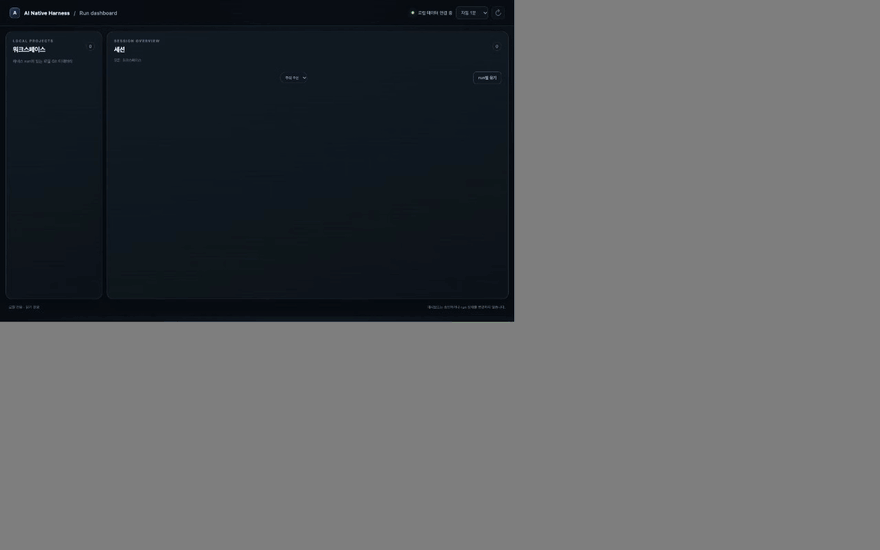

_합성 데모 데이터로 녹화한 화면입니다. 승인 대기 필터 → 워크스페이스 선택 → 세션 "자세히보기" →
run 진행·게이트·스킬/리뷰/검증 요약 → 단위 테스트 상세 → 다음 세션 이동 → run별 묶기 순서로 동작합니다._

## 실행

하네스 저장소에서 `npm run dashboard`를 실행한 뒤 터미널에 표시되는 `127.0.0.1` 주소를
브라우저에서 엽니다. macOS 터미널과 Windows PowerShell에서 같은 명령을 사용하며 `Ctrl+C`로
종료합니다.

## 표시 범위

대시보드는 지원되는 GitHub Copilot CLI, Claude Code, Codex의 로컬 세션 파일과 해당
워크스페이스의 SDLC run 증거를 읽기 전용으로 표시합니다. 세션 내용은 외부로 업로드되지
않으며, 지원되지 않는 로컬 형식은 누락되거나 경고로 표시될 수 있습니다.

- 세션은 하네스 도구 실행 기록(예: `docs/sdlc/<ID>/state.json`을 다루는 명령이나 파일 경로)으로
  run에 자동 연결되며, 여러 run을 오간 세션은 가장 최근 run에 연결됩니다. 연결되지 않은 세션은
  직접 연결할 수 있고, 자동 연결도 수동으로 변경할 수 있습니다.
- 스킬 · 리뷰 · 검증 요약은 스킬별 호출 횟수, 리뷰 차단 건수, 단위/API/E2E 검증의 최근 결과만
  압축해 보여 줍니다. `;`, `||`, `|`로 이어진 명령처럼 종료 코드가 검사 결과를 증명하지 못하면
  결과를 미확인으로 둡니다.
- 승인 대기는 run의 다음 차례 게이트가 아직 승인되지 않은 사람 게이트(G1·G2·G5b)일 때만
  강조합니다. 대시보드는 승인 상태를 표시하지만 승인하거나 run 상태를 변경하지 않습니다.

## 세션 열기와 알림

세션 카드에는 VS Code 링크와 **명령 복사** 버튼이 있습니다. Copilot CLI 세션의 **VS Code에서
세션 열기**는 워크스페이스를 열고 세션을 VS Code 채팅으로 가져옵니다. VS Code 에이전트 호스트가
가져올 수 있는 세션, 즉 VS Code에서 만든 세션과 VS Code 실행 중에 감지된 CLI 세션만 열립니다.
그 밖의 오래된 CLI 세션은 VS Code에서 가져오기 오류가 표시됩니다. Claude Code와 Codex CLI 세션은
VS Code가 가져오지 못하므로 **VS Code 폴더 열기**로 표시되며 워크스페이스만 엽니다. **명령 복사**는
`copilot --resume <id>`, `claude --resume <id>`, `codex resume <id>`를 복사하므로 터미널에서 세션을
이어 갈 수 있습니다.

오래된 세션 생략 같은 스냅샷 경고는 왼쪽 아래 **알림 N건** 버튼에 접혀 있으며 누르면 펼쳐집니다.
대시보드를 읽지 못한 오류는 화면 위쪽에 그대로 표시됩니다.

## 새로고침

화면은 기본적으로 60초마다 자동 새로고침됩니다. 상단의 주기 선택에서 자동 10초·30초·1분·5분
또는 수동을 고를 수 있고, 선택한 값은 브라우저에 저장됩니다. ↻(지금 새로고침) 버튼은 모드와
관계없이 즉시 다시 읽습니다.

## 읽기·저장 위치

| 항목 | 위치 |
|---|---|
| 세션 | 사용자 홈 디렉터리의 `.copilot`, `.claude`, `.codex` (Windows는 `%USERPROFILE%\.copilot` 등) |
| 수동 연결 설정 (macOS) | `~/Library/Application Support/ai-native-harness/dashboard.json` |
| 수동 연결 설정 (Windows) | `%APPDATA%\ai-native-harness\dashboard.json` |
