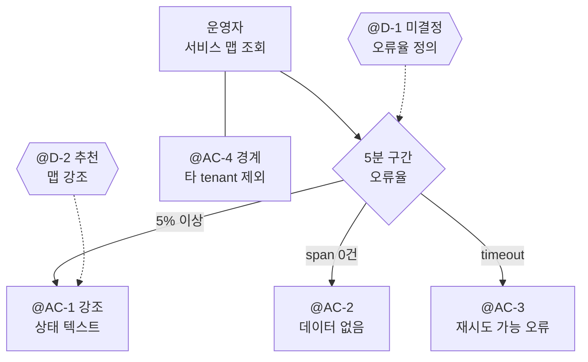

# ABC-123 디스커버리 (가상 예시)

## Approval summary

### Goal

운영자가 서비스 관계를 보면서 오류 증가를 식별한다.

### Scope

Grafana 서비스 맵의 5분 구간 오류율, 데이터 없음, 조회 오류 표시.

### Non-goals

ClickHouse 직접 호출, SigNoz UI 노출, 인증 정책 변경과 배포.

### Behavior

아래 동작은 요구사항 초안이다. 육각형은 사람의 결정이며 실선은 제안된 동작 흐름이다.

### Review

| ID   | Status      | Summary                                                               |
|------|-------------|-----------------------------------------------------------------------|
| AC-1 | defined     | 5분 오류율이 5% 이상이면 노드 강조와 텍스트 상태를 함께 표시한다.           |
| AC-2 | defined     | 분모 0이면 0%나 정상이 아니라 데이터 없음으로 표시한다.                    |
| AC-3 | defined     | query-service timeout은 재시도 가능한 오류로 표시한다.                    |
| AC-4 | defined     | 다른 tenant의 서비스는 응답과 화면에서 제외한다.                           |
| D-1  | open        | 도메인 담당자가 오류율 정의를 확인해야 한다. 관련 AC 확정 전 답이 필요하다. |
| D-2  | recommended | 제품 담당자에게 맵 강조를 추천한다. 정렬 표는 비교가 쉽지만 관계 파악이 약하다. |
| R-1  | noted       | 타 tenant 노출 위험: 기존 인증 경계를 유지하고 응답과 화면 모두 검증한다.   |

### Approval

G0/G1은 pending이며 실제 승인 요청이나 승인 증거가 아니다.
@D-1과 필요한 화면 검토를 마친 뒤 요구사항, [FE 시나리오](features/error-rate.feature),
BE AC 및 프로토타입 증거를 함께 승인한다. 승인 범위는 계획 진입까지이며
구현·배포 허가가 아니다. @D-2는 G1 승인 전까지 추천안이다.

## Acceptance criteria

| ID   | Criterion                                                               | Verification                                  |
|------|-------------------------------------------------------------------------|-----------------------------------------------|
| AC-1 | @D-1 정의의 에러율이 5% 이상이면 노드를 강조하며 텍스트 상태도 표시한다.       | FE 시나리오, BFF 계산 예시와 단위 테스트          |
| AC-2 | @D-1 정의의 분모 0인 서비스는 데이터 없음 상태이며 정상으로 표시하지 않는다. | FE 시나리오, 분모 0 API 예시                     |
| AC-3 | query-service timeout은 사용자에게 재시도 가능한 오류로 보인다.             | FE 시나리오, BFF timeout 계약 테스트              |
| AC-4 | 다른 tenant의 서비스는 응답과 화면에 포함되지 않는다.                       | BFF tenant 격리 테스트, Grafana 노출 검증          |

## Decisions

| ID  | Timing | Impact   | Status      | Choice                                                                           | Owner         | Evidence |
|-----|--------|----------|-------------|----------------------------------------------------------------------------------|---------------|----------|
| D-1 | now    | standard | open        | 확인할 정의: 5분 구간의 오류 server span 수 / 전체 server span 수, 분모 0은 데이터 없음 | 도메인 담당자 | -        |
| D-2 | g1     | standard | recommended | 서비스 관계를 유지하는 맵 강조안                                                    | 제품 담당자   | -        |

## Risks

| ID  | Risk                  | Mitigation                                        | Decision |
|-----|-----------------------|---------------------------------------------------|----------|
| R-1 | 다른 tenant의 정보 노출 | 기존 인증 경계 유지, @AC-4의 응답·화면 격리 검증     | -        |

## Context and evidence

사용자는 Grafana 서비스 맵을 보는 관측 플랫폼 운영자다.
모듈 경계는 Grafana panel/app → datasource → Spring BFF → SigNoz query-service다.
ClickHouse 직접 호출과 SigNoz UI 노출은 제외한다.
이 문서는 가상 예시이며 실제 Jira 조회나 프로젝트 표준/ADR 확인 증거가 없다.

@D-1의 초안은 UTC epoch milliseconds와 서비스 합산 시 분모 합산을 제안한다.
실제 도메인 담당자의 확인이 필요하며 사용자 답변으로 취급하지 않는다.
@D-2의 대안인 정렬 표는 오류율 순위 비교에 유리하지만 서비스 관계를 덜 드러낸다.
라이트/다크, 색각 이외의 상태 구분, keyboard focus, loading/empty/error 상태를
실제 Grafana sandbox에서 검토해야 한다. 선택이나 미리보기는 G1 승인이 아니다.
