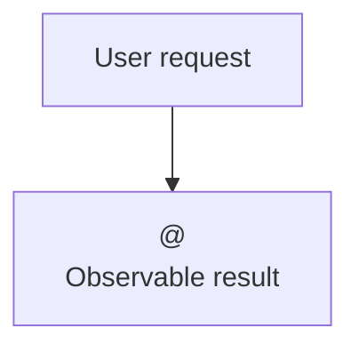

# <ID> Discovery

## Approval summary

### Goal

<One sentence describing the user's outcome.>

### Scope

<Included behavior and affected users.>

### Non-goals

<Excluded behavior; name every deferred decision with @D-ID.>

### Behavior

### Review

| ID      | Status  | Summary                                                        |
|---------|---------|----------------------------------------------------------------|
| <AC-ID> | defined | <Observable outcome, including meaningful conditions or limits> |

### Approval

Approve the requirements in this revision and its referenced FE scenarios, BE
examples and applicable prototype evidence. This permits planning, not
implementation or deployment. Recommended choices are proposals until G1 passes.
Confirm high-impact recommendations individually with their designated owners.
Changed choices require an updated summary and confirmation of the changed scope.

## Acceptance criteria

| ID      | Criterion                                      | Verification                         |
|---------|------------------------------------------------|--------------------------------------|
| <AC-ID> | <Exact observable behavior and error conditions> | <Scenario, API example or test check> |

## Decisions

| ID | Timing | Impact | Status | Choice | Owner | Evidence |
|----|--------|--------|--------|--------|-------|----------|

## Risks

| ID | Risk | Mitigation | Decision |
|----|------|------------|----------|

## Context and evidence

<Record the request reference, users, glossary, existing behavior, module map,
decision alternatives and consequences, reversible assumptions, and evidence
paths. Reference applicable standards/ADRs and owners; record missing governance
or conflicts explicitly. Link FE scenarios, BE examples and prototype evidence,
or explain inapplicability. Keep material scope, choices and risks in the summary,
not only here. Remove these instructions after drafting.>
